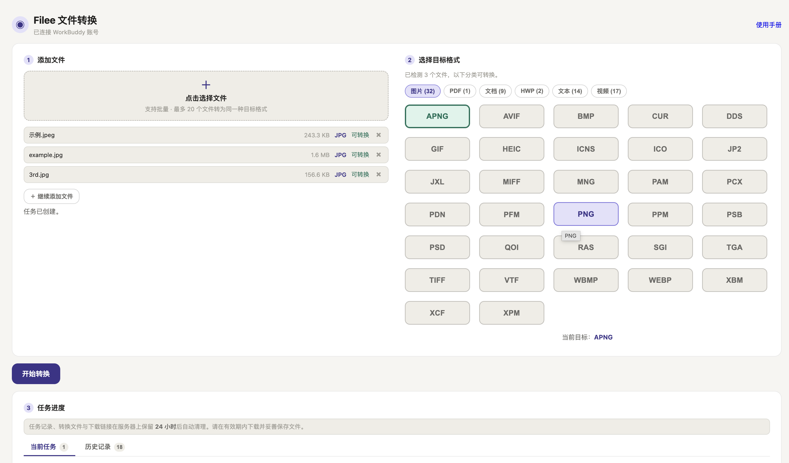

# Filee · WorkBuddy Self-Hosted Web App Edition



This is an edition of the [Filee](https://github.com/KnifeLemon/Filee) conversion engine packaged as a **WorkBuddy self-hosted app**: open a web page from the WorkBuddy menu with single sign-on, upload files, pick a target format, convert, and download. Everything runs on the server; nothing is installed on the client.

Forked from Filee, licensed under the upstream **MIT** license.

[简体中文](README.md)

---

## How this differs from the upstream repo

Upstream Filee is a desktop app (Avalonia) where you drop files onto a donut menu. This branch keeps the conversion engine and the format whitelist, but changes the following:

| Aspect | Upstream | This branch |
|---|---|---|
| Usage | Desktop client, drag and drop | Web page from the WorkBuddy menu, click to pick files |
| Identity | None | OIDC (OpenID Connect) single sign-on: the platform lands on `/sso` with a one-time code, the backend exchanges and verifies it, then issues a session cookie |
| UI | Native Avalonia donut | HTML grid for formats, batch file list, task progress tabs, download-all zip |
| Configuration | App settings | Single `appsettings.local.json`, one-command `start.sh`, environment-variable overrides |
| Deployment | Installer | Long-running local service (`https://<host>:<port>`); no database shipped, an empty one is created on first run |
| Engines | Bundled/downloaded by the desktop app | Discovered from `engines/` or system PATH at runtime; engine binaries are **not** included in this repository |
| Capability scope | Full engine capabilities | Web whitelist narrowed: OCR, speech transcription, AI upscaling and machine translation are disabled; a few formats unsupported by the current engine are hidden |

The conversion core still comes from upstream: format registry, conversion engines (FFmpeg, LibreOffice, Ghostscript, calibre, pandoc, 7-Zip, ExifTool, rhwp), file magic validation and concurrency control. The Web layer lives in `src/Filee.Web/`.

---

## Features

- **Batch conversion**: up to 20 files per job, all converted to one target format
- **Smart filtering**: after adding files, only targets common to all of them are listed
- **Task progress**: live progress, localized status labels, a history tab (retained for 24 hours)
- **Download all**: batch jobs can download every result as a single zip
- **Format coverage**: about 234 source formats and nearly 8,000 conversion paths, spanning images, PDF, documents, spreadsheets, presentations, text, audio/video, subtitles and archives
- **Data retention**: files, job records and download links are automatically cleaned up after 24 hours

OCR (optical character recognition), speech transcription, AI upscaling and machine translation are not supported. Writing results directly into a chosen local folder is also unavailable because the WorkBuddy iframe does not grant file-system access.

---

## Deployment

**Prerequisites** — Linux or macOS with the following installed:
- **.NET SDK 10** (not just the Runtime) — the repository contains no prebuilt binaries. `start.sh` launches with `dotnet run -c Release`, which **builds automatically** on first run and after any source change.
- **Python 3** — `start.sh` uses it to read the JSON config and export environment variables.
- The third-party conversion engines for your platform (see "Engines" below).

```bash
# 1. Get the source
git clone https://github.com/Fab-Vermilion/Filee.git
cd Filee
git checkout wbapp

# 2. Prepare configuration
cp appsettings.local.json.example appsettings.local.json
# Edit appsettings.local.json: listen address, SSO callback, Client ID/Secret, certificate

# 3. Build once (optional but recommended: surfaces errors early, confirms SDK version)
dotnet build src/Filee.Web/Filee.Web.csproj -c Release

# 4. Start (start.sh ensures a build, then runs the service in the foreground)
./start.sh
```

Step 3 can be skipped because `dotnet run` in `start.sh` builds automatically; doing a separate build first just catches problems earlier. There are no `bin/`, `dist/` or other build artifacts in the repository — a build is required after cloning.

An empty database is created automatically on first run (or run `./init-db.sh` explicitly). The database stores only job records — no keys or SSO configuration.

### Configuration essentials

- `Server.urls`: listen address; `Server.redirectUri`: SSO callback. They must use the same host and port.
- `Sso.*`: issuer, audience, clientId and clientSecret come from the self-hosted app's `Client_profile` in WorkBuddy.
- `Tls.pfxPath` / `password`: HTTPS certificate (required by the WorkBuddy iframe).
- All fields are described in `appsettings.local.json.example`; see `DEPLOY.md` for more detail.

### WorkBuddy setup

Create a self-hosted app in the WorkBuddy console, set its SSO callback to the configured `Server.redirectUri`, and bind the menu to that app.

---

## Engines (prepare them yourself)

**No third-party conversion engine binaries are included in this repository.** Upstream Filee defines a per-platform mechanism to obtain engines, which this project reuses. Before deploying, prepare the engines for your target platform and place them under `engines/` or install them on the system PATH:

- FFmpeg, LibreOffice, Ghostscript, calibre, pandoc, 7-Zip, ExifTool, rhwp

At runtime the app first probes `engines/<id>/` for a portable copy, then falls back to the system PATH. Refer to upstream Filee's engine documentation for exact versions, directory layout and platform differences. Conversions whose engine is missing will be unavailable.

---

## License

MIT License — see [LICENSE](LICENSE). Copyright belongs to the original author Myeonggu Kim (KnifeLemon) and the Filee contributors; changes in this branch are also released under MIT.
