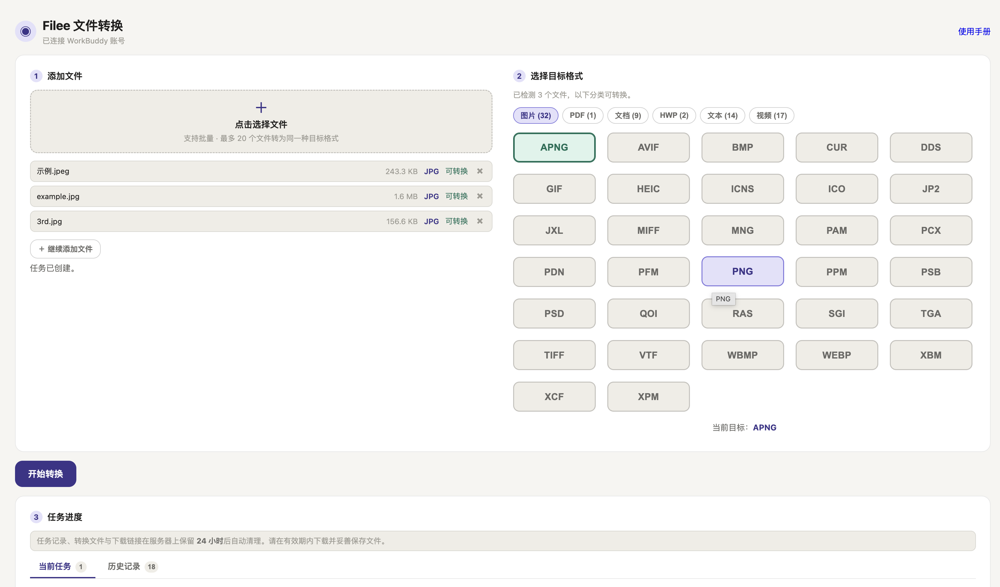

# Filee · WorkBuddy 自建 Web 应用版



这是一个把 Filee 文件转换引擎包装成 **WorkBuddy 自建应用**的版本：通过 WorkBuddy 菜单免登进入一个网页，上传文件、选择目标格式、转换、下载。全程在服务器上完成，用户端零安装。

fork 自 Filee，沿用上游 **MIT** 许可证。

[English](README.en.md)

---

## 与原仓库的区别

原仓库 Filee 是一个桌面应用（Avalonia），通过拖放文件到甜甜圈菜单完成转换。本分支保留其转换引擎与格式白名单，但做了以下改造：

| 方面 | 原仓库 | 本分支 |
|---|---|---|
| 使用方式 | 桌面客户端，拖放文件 | WorkBuddy 自建菜单打开网页，点击选文件 |
| 身份 | 无 | OIDC（OpenID Connect，开放身份连接）免登：平台带一次性 code 落地 `/sso`，后端换票验签后下发会话 Cookie |
| 界面 | Avalonia 原生甜甜圈 | HTML 网格选格式、批量文件列表、任务进度页签、全部下载 zip |
| 配置 | 应用设置 | 单一 `appsettings.local.json`，一键 `start.sh`，环境变量可覆盖 |
| 部署 | 安装包 | 常驻本地服务（`https://<host>:<port>`），部署不带数据库，首次运行自动建空库 |
| 引擎 | 桌面端随安装/下载 | 运行时从 `engines/` 或系统 PATH 探测；引擎二进制不包含在本仓库中，需自行准备 |
| 能力边界 | 完整引擎能力 | Web 白名单收窄：禁用 OCR、语音转录、AI 超分、机器翻译；隐藏当前引擎不支持的少量格式 |

转换核心仍来自上游：格式注册表、转换引擎（FFmpeg、LibreOffice、Ghostscript、calibre、pandoc、7-Zip、ExifTool、rhwp）、文件魔数校验与并发控制。Web 层新增的代码集中在 `src/Filee.Web/`。

---

## 功能

- **批量转换**：一次最多 20 个文件，统一转为同一种目标格式
- **智能过滤**：添加文件后只列出这些文件共同可转换的目标
- **任务进度**：实时进度、状态中文化、历史记录页签（保留 24 小时）
- **一次打包下载**：批量任务可下载 zip
- **格式覆盖**：约 234 种源格式、近 8000 条转换路径，涵盖图片、PDF、文档、表格、演示、文本、音视频、字幕、压缩包等
- **数据存储**：文件、任务记录与下载链接保留 24 小时后自动清理

不支持 OCR（光学字符识别）、语音转录、AI 超分（图像放大重建）、机器翻译，也不做"直接写入本地指定目录"（WorkBuddy iframe 未放通文件系统权限）。

---

## 部署

**前置条件**：Linux 或 macOS，并提前安装：
- **.NET SDK 10**（不是 Runtime）——仓库里没有任何预编译产物，`start.sh` 内部用 `dotnet run -c Release` 启动，它在首次运行和每次源码变更后都会**自动执行构建**
- **Python 3**——`start.sh` 用它读取 JSON 配置并导出环境变量
- 目标平台对应的第三方转换引擎（见下方"引擎"一节）

```bash
# 1. 拉取源码
git clone https://github.com/Fab-Vermilion/Filee.git
cd Filee
git checkout wbapp

# 2. 准备配置
cp appsettings.local.json.example appsettings.local.json
# 编辑 appsettings.local.json：填监听地址、免登回调地址、Client ID/Secret、证书等

# 3. 首次构建（可选但推荐：提前暴露编译错误，也便于确认 SDK 版本）
dotnet build src/Filee.Web/Filee.Web.csproj -c Release

# 4. 启动（start.sh 会再次确保已构建，然后常驻运行）
./start.sh
```

第 3 步可省略——`./start.sh` 里的 `dotnet run` 会自动构建；但先单独 build 一次能更早发现问题。仓库不含 `bin/`、`dist/` 等任何构建产物，克隆后必须构建。

首次运行自动创建空数据库（也可先跑 `./init-db.sh` 显式建库）。数据库只存任务记录，不含任何密钥或 SSO 配置。

### 配置要点

- `Server.urls`：监听地址；`Server.redirectUri`：免登回调地址，两者必须同域名同端口
- `Sso.*`：issuer、audience、clientId、clientSecret 从 WorkBuddy 自建应用的 `Client_profile` 获取
- `Tls.pfxPath` / `password`：HTTPS 证书（WorkBuddy iframe 要求 HTTPS）
- 完整字段说明见 `appsettings.local.json.example` 顶部；更详细的部署说明见 `DEPLOY.md`

### WorkBuddy 侧配置

在 WorkBuddy 控制台创建自建应用，把免登回调地址填为配置里的 `Server.redirectUri`，然后把菜单绑定到该应用。

---

## 引擎（需自行准备）

**本仓库不包含任何第三方转换引擎二进制。** 上游 Filee 提供按平台获取引擎的机制，本项目沿用；部署时需按目标平台自行准备以下引擎，放到 `engines/` 目录或安装在系统 PATH 上：

- FFmpeg、LibreOffice、Ghostscript、calibre、pandoc、7-Zip、ExifTool、rhwp

程序运行时优先探测 `engines/<id>/` 下的便携副本，其次查找系统 PATH。具体版本、目录布局与平台差异请参考上游 Filee 的引擎文档；未安装的引擎对应的转换目标将不可用。

---

## 许可证

MIT License — 见 [LICENSE](LICENSE)。版权归原作者 Myeonggu Kim (KnifeLemon) 及 Filee 贡献者；本分支的改动同样以 MIT 开源。
